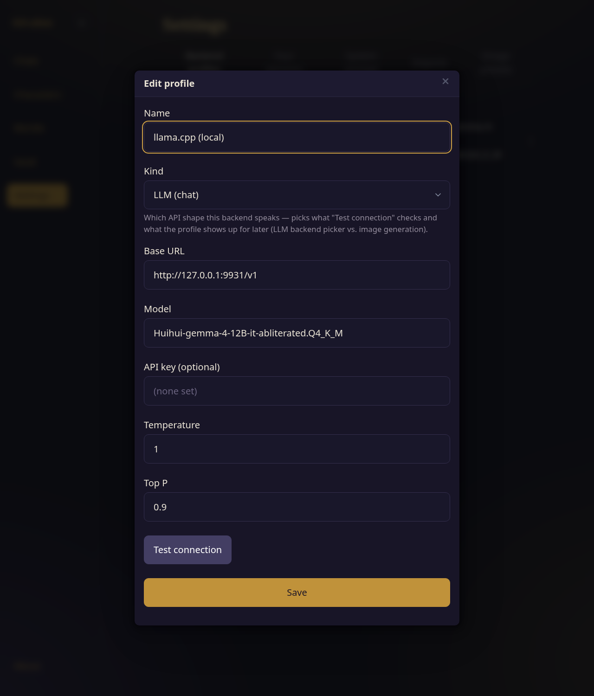
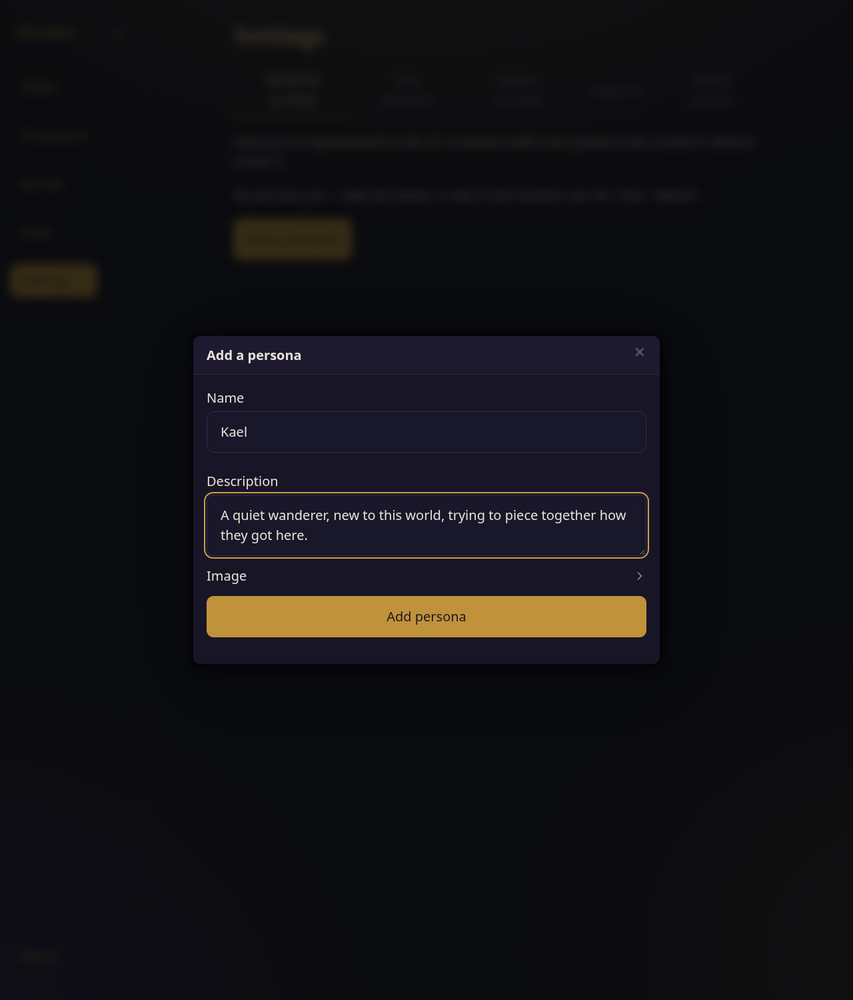
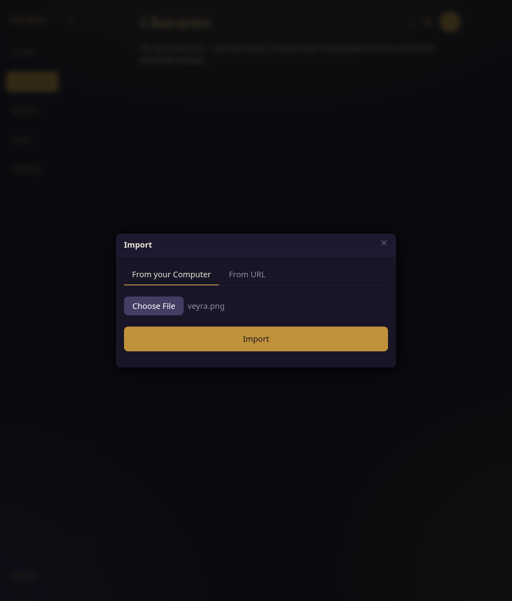
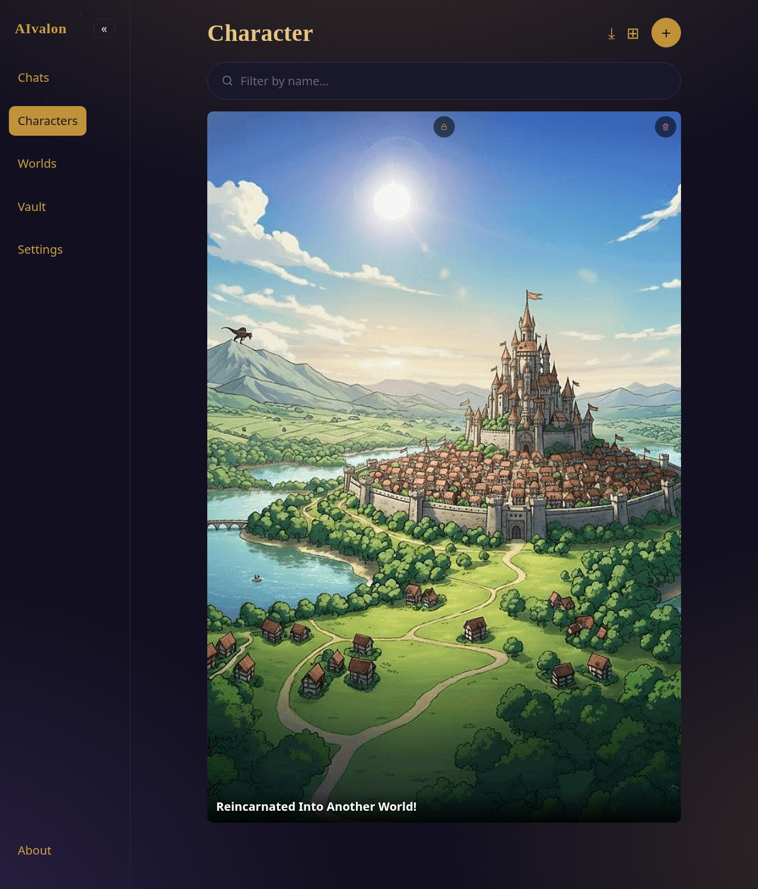
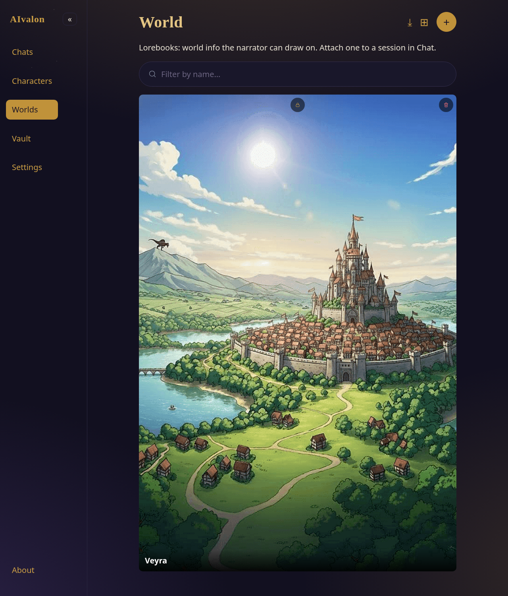
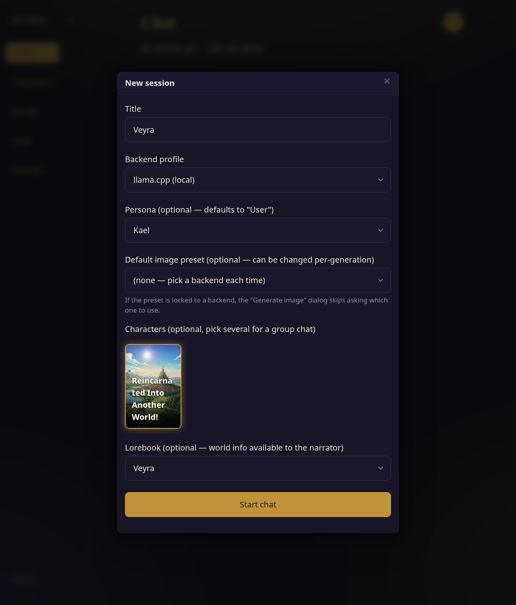
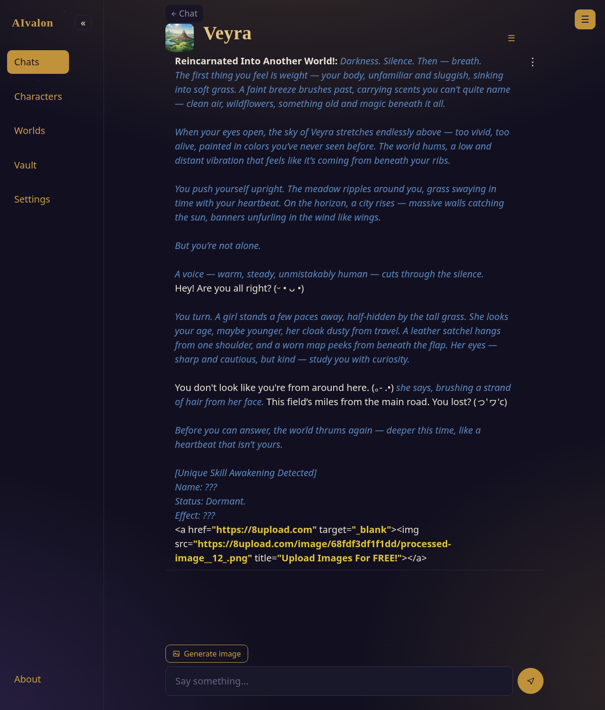
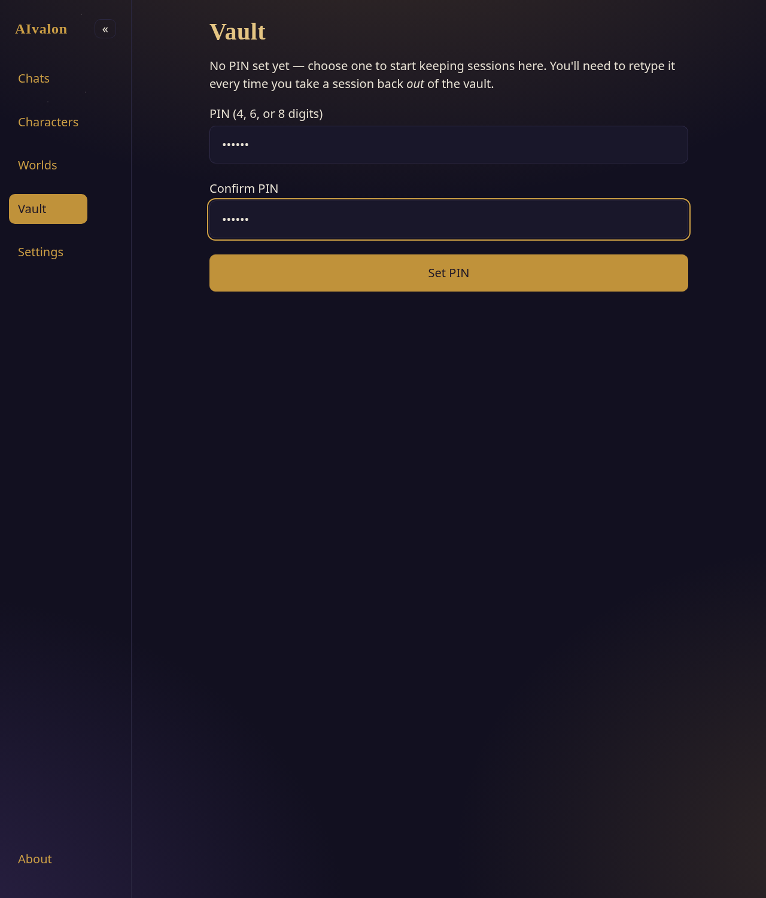
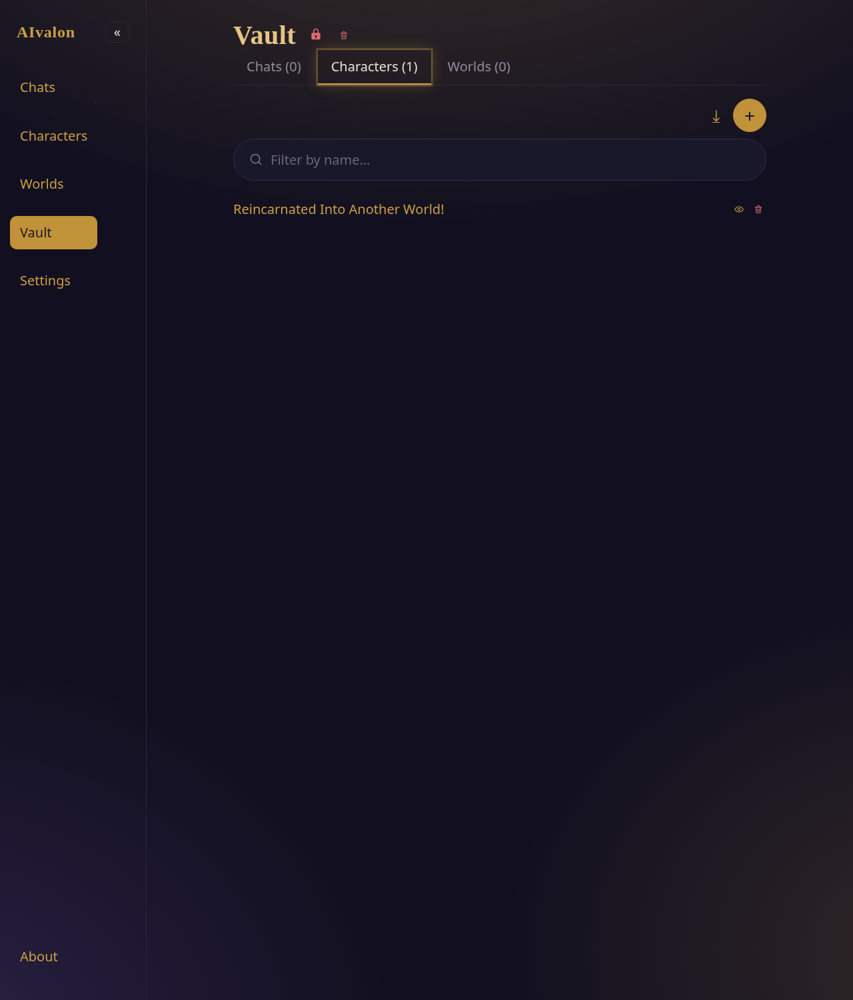

# AIvalon

🇫🇷 [Lire en français](README_fr.md)

A local, single-user web app for AI roleplay.
It replaces rate-limited hosted apps: you talk to an LLM that runs on your own machine, through persona cards and lorebooks you control, and nothing leaves your computer.

> **Status: v0.2-beta-1, image generation off by default.**
> Chat, character cards, personas, lorebooks, backend profiles, and the Vault (PIN-gated, fully encrypted at rest) work end-to-end against a real LLM backend.
> Image generation (against an AUTOMATIC1111/Forge backend) is code-complete but **disabled by default in this release** — it hasn't had a real validation pass yet. `docs/DESIGN.md` is the source of truth for what's settled versus still open.

**Language:** a small badge above the **About** link in the sidebar switches the UI language — English by default, more added by dropping a `.json` file in `web/static/i18n/` (French ships with this release). It also tells the backend LLM to reply in that language. Not every screen is translated yet — the nav, sidebar, and About page are; Chat/Character/World/Vault/Settings still show English text regardless of the switcher (tracked, see `docs/DESIGN.md`'s Internationalization section).

## Getting started

Everything below works the same on Windows and Linux — screenshots are from Linux, the Windows side just has a `.exe` and double-clicks instead of a terminal.

### 1. Install (recommended: the one-command installer)

Run `./scripts/install.sh` (Linux) or `scripts/install.ps1` (Windows: `powershell -NoProfile -ExecutionPolicy Bypass -File install.ps1`). That's the only command. It asks for an install directory, then downloads and unpacks llama.cpp (CPU build), a bundled low-end default model ([Qwen2.5-3B-Instruct](https://huggingface.co/bartowski/Qwen2.5-3B-Instruct-GGUF), ~2 GB) and AIvalon itself. At the end it offers to create a shortcut: a desktop shortcut on Windows, an application-menu entry on Linux. Nothing else to do. Launch the generated launcher script (`run-aivalon.sh` / `run-aivalon.ps1`, in the install directory) and open `http://127.0.0.1:4140`.

The launcher starts llama.cpp for you, and AIvalon shuts it down when it exits. While the model loads, the browser shows a loading screen that turns into the app on its own. A preconfigured **llama.cpp (local)** backend profile already points at it. Re-running the installer skips whatever is already in place.

### Advanced / do it yourself

Skip the installer if you want a different or bigger model, a GPU build of llama.cpp, your own backend (Ollama, a hosted API), or just to see what's going on.

#### Get a local LLM running (llama.cpp)

AIvalon never embeds inference itself — it talks to any OpenAI-compatible backend over HTTP. [llama.cpp](https://github.com/ggml-org/llama.cpp)'s server is the straightforward local option and what these instructions use; [Ollama](https://ollama.com/) also works if you'd rather manage models that way.

1. Download a prebuilt archive from [llama.cpp's Releases page](https://github.com/ggml-org/llama.cpp/releases) matching your OS and GPU: `cuda` for an Nvidia card, `vulkan` as a safe cross-vendor fallback (AMD/Intel/Nvidia alike), plain `cpu` if you have no GPU worth using. Unzip it anywhere — there's nothing to install. The server executable inside is called `llama-server` on most builds (some newer ones expose it as a unified `llama` CLI with a `serve` subcommand instead — same thing, adjust the command below accordingly).
2. Grab a model in **GGUF** format. Pick the tier that matches your GPU's VRAM:

   | Tier            | Model                                                                                                           | VRAM (approx.)     | Notes                                                                                                                           |
   | --------------- | --------------------------------------------------------------------------------------------------------------- | ------------------ | ------------------------------------------------------------------------------------------------------------------------------- |
   | Low-end (~3B)   | [Qwen2.5-3B-Instruct-GGUF](https://huggingface.co/bartowski/Qwen2.5-3B-Instruct-GGUF)                           | ~2 GB at Q4_K_M    | General-purpose, not roleplay-tuned specifically, but the strongest all-rounder this small. Runs on almost anything with a GPU. |
   | Mid-end (~8B)   | [Huihui-Qwen3-8B-abliterated-v2](https://huggingface.co/huihui-ai/Huihui-Qwen3-8B-abliterated-v2)               | ~5 GB at Q4_K_M    | Good character-card adherence, fits comfortably on an 8 GB card.                                                                |
   | Mid-end (~12B)  | [Huihui-gemma-4-12B-it-abliterated](https://huggingface.co/mradermacher/Huihui-gemma-4-12B-it-abliterated-GGUF) | ~9-10 GB at Q4/Q5  | A step up if you have 12 GB (e.g. an RTX 4070 Ti), noticeably more coherent over long scenes.                                   |
   | High-end (~24B) | [Dolphin3.0-Mistral-24B](https://huggingface.co/dphn/Dolphin3.0-Mistral-24B)                                    | ~16-20 GB at Q4-Q6 | Dense 24B, the established pick for long-form creative/roleplay output once you have the VRAM for it.                           |

   "Abliterated" means the model's refusal/alignment layer has been removed — the usual reason a model is listed here instead of its plain instruct version is that standard instruct models tend to break character and insert safety disclaimers mid-scene. Swap in the non-abliterated GGUF for the same base model if you'd rather keep that layer; AIvalon doesn't care which you point it at.
3. Put the `.gguf` file(s) in a folder, then launch the server pointed at it:

   ```sh
   llama-server -cmoe -rea off --sleep-idle-seconds 15 -c 8192 --models-dir <path to your models folder>
   ```

   What each flag does:
   - `--models-dir` runs llama.cpp in **router mode**, serving every model in that folder — this is what lets AIvalon's "Test connection" detect and list them below.
   - `-cmoe` (`--cpu-moe`) keeps Mixture-of-Experts weights on the CPU — saves VRAM on MoE models, a harmless no-op on dense ones.
   - `-rea off` (`--reasoning off`) turns off chain-of-thought "thinking" output — you want the model's in-character reply, not its visible reasoning trace, for roleplay.
   - `--sleep-idle-seconds 15` unloads the model from VRAM after 15 seconds idle, freeing the GPU for anything else in the meantime.
   - `-c 8192` (`--ctx-size`) is the context window, in tokens. Keep AIvalon's own context budget (Settings → System prompt) comfortably under this.

   Leave this running in its own terminal (or as a background service, once you're past trying things out). If you'd rather have AIvalon start and stop it for you the way the installer does, set `AIVALON_LLAMA_BIN` and `AIVALON_LLAMA_MODELS_DIR` instead (see Environment variables below).

#### Get AIvalon

Download the release archive for your OS (`aivalon-linux-x64.tar.gz` / `aivalon-windows-x64.zip`), extract it anywhere, and run the executable from inside its folder. There's no separate runtime to set up. Keep the `web/` folder next to the binary. On Windows, SmartScreen may warn about the binary because it isn't signed.

AIvalon listens on `http://127.0.0.1:4140` by default — open that in a browser.

### 2. First-run settings

If you used the installer, the **llama.cpp (local)** profile is already set up (Temperature 1.0, Top P 0.9), so skip to the persona below. Otherwise, edit that profile or open **Settings → Backend profiles → Add a profile**, name it, point **Base URL** at your llama.cpp server (e.g. `http://127.0.0.1:9931/v1`), then hit **Test connection** — a successful test lists every model the server found and turns the Model field into a dropdown so you can pick one instead of typing it by hand. For roleplay, **Temperature ≈ 1.0** and **Top P ≈ 0.9** are a reasonable starting point — more coherent than default sampling, without being flat.



Then, on the **Your persona** tab, add yourself as a persona — who you are to the AI, separate from the characters it plays. Optional: a chat with none picked just uses a built-in "User" default.



### 3. Import a character (and its lorebook)

Character cards use the open SillyTavern-compatible format, so anything exported from sites built around it works here too. As an example: [Veyra on Character Tavern](https://character-tavern.com/character/baconery/veyra) — hit the purple **Download character card** button (PNG, lorebook included). That one download gives you both a character *and* a lorebook, since the card has a world/lore section embedded in it.

Go to **Characters**, click the ⤓ import button, and drop the PNG in:



The character lands in your list, and its embedded lorebook shows up on its own in **Worlds** — nothing extra to do:




### 4. Start your first chat

Go to **Chat → New session**: pick a title (e.g. "Veyra"), your backend profile, your persona, the character(s) you just imported, and the lorebook, then **Start chat**.





## The Vault

A PIN-gated space to pull a character card, lorebook, or whole session out of casual view — a 4, 6, or 8-digit PIN of your choice, re-prompted every time you open the Vault or take something back out of it (a lockout kicks in after repeated wrong guesses). Everything hidden in there — session images, character portraits, lorebook covers — is **encrypted at rest** (AES-256-GCM), not just hidden behind a UI gate: looking directly at the files on disk gets you ciphertext, not a picture.




## What it does

- **Character cards**, following the Character Card V2/V3 spec (the same format used across the existing SillyTavern-adjacent ecosystem): import from a PNG (with the card embedded in a `tEXt` chunk) or plain JSON, from a file or a URL, or write one by hand. Multiple reference images per card, with one promotable to primary/avatar.
- **Personas**: your own self-profile as the human player, separate from the characters the AI plays. Optional — a session with none picked falls back to a built-in default.
- **Lorebooks** (World Info): shared lore kept separate from character cards on purpose, with per-entry trigger strategy (`constant` or whole-word `selective`), insertion order, and probability. Importable the same way as character cards, and auto-extracted from a card that embeds one.
- **Chat**, with multiple character cards in one session for group roleplay: streamed token-by-token over SSE, with per-message regenerate, edit, branch (fork the conversation from any point), and delete, plus session duplication and a custom background per session.
- **Any OpenAI-compatible LLM backend**: point one or more backend profiles at Ollama, a llama.cpp server, or a hosted API, with a connection test/ping from Settings — AIvalon never embeds inference itself.
- **On-demand image generation** *(disabled by default in release builds, not yet validated)*, against an AUTOMATIC1111 (A1111)/Forge Stable Diffusion WebUI backend. Named image presets (steps, CFG scale, sampler, size, seed, negative prompt, style suffix) are managed once in Settings, and a session just picks one; the in-chat dialog only ever asks for the prompt.
- **The Vault** — see above.
- **Settings**: backend profiles, personas, the system prompt template, a context budget (character cap on what's sent per reply), and the hostname whitelist for "import a card from a URL".

Full rationale for every one of these choices is in `docs/DESIGN.md`.

## Installing (for developers / building from source)

The section above is for everyone else — this one is for building AIvalon itself rather than running a release.

### Prerequisites

1. **Go 1.22 or newer** — [go.dev/dl](https://go.dev/dl/).
2. A local LLM backend to test against (see Getting Started above).

### Build and run

```sh
git clone https://github.com/Lord-ZuzurNC/AIvalon.git
cd AIvalon
go build -o aivalon ./cmd/aivalon
./aivalon
```

### Environment variables

| Variable                            | Default          | Purpose                                                                                                                                                                                                                                                       |
| ----------------------------------- | ---------------- | ------------------------------------------------------------------------------------------------------------------------------------------------------------------------------------------------------------------------------------------------------------- |
| `AIVALON_ADDR`                      | `127.0.0.1:4140` | Listen address. Setting a non-loopback address relaxes the DNS-rebinding guard for private-LAN Host headers on the same port.                                                                                                                                 |
| `AIVALON_DB`                        | `aivalon.db`     | SQLite file path, so two instances don't fight over the same database.                                                                                                                                                                                        |
| `AIVALON_TRANSLATE_TIMEOUT_SECONDS` | `200`            | Per-field/per-entry timeout (seconds) for the character/lorebook import translation feature — raise it if a slower local model times out mid-generation, see `docs/DESIGN.md`.                                                                                |
| `AIVALON_LLAMA_BIN`                 | *(unset)*        | Path to `llama-server`. Set together with `AIVALON_LLAMA_MODELS_DIR` to have AIvalon start llama.cpp itself (router mode, on the "llama.cpp (local)" profile's port), wait until it's healthy, and stop it on exit. Leave both unset to run your own backend. |
| `AIVALON_LLAMA_MODELS_DIR`          | *(unset)*        | Folder of `.gguf` models served by that llama.cpp process.                                                                                                                                                                                                    |

## Tech stack (summary)

- **Go**, single static binary — no runtime to install for end users.
- **SQLite** (`modernc.org/sqlite`, pure Go, no cgo) for storage; `goose` for migrations.
- **htmx** + server-rendered Go templates (`templ`) for the UI — no separate JavaScript build, no Node/npm dependency.
- **Server-Sent Events** for streaming chat tokens.
- Talks to any OpenAI-compatible `chat/completions` API and to an A1111-compatible `/sdapi/v1/txt2img` endpoint; never embeds an inference or image-generation engine itself.

Full reasoning for every choice above — including what was considered and rejected — lives in `docs/DESIGN.md`.

## Development

```sh
go install github.com/a-h/templ/cmd/templ@latest   # regenerate .templ -> _templ.go after editing a template
go install github.com/pressly/goose/v3/cmd/goose@latest   # add/run DB migrations

templ generate && go build -o aivalon ./cmd/aivalon
go test ./...
```

Migrations live as plain `.sql` files in `internal/db/migrations/`; add a new one rather than editing an existing migration. Generated `_templ.go` files are committed, so a bare `go build` works without the `templ` CLI installed — only editing a `.templ` file requires it.

## License

AGPLv3 — see `LICENSE`.
Running AIvalon locally, for yourself, carries no obligation.
Modifying it and running it as a network service for other people means publishing those modifications.
