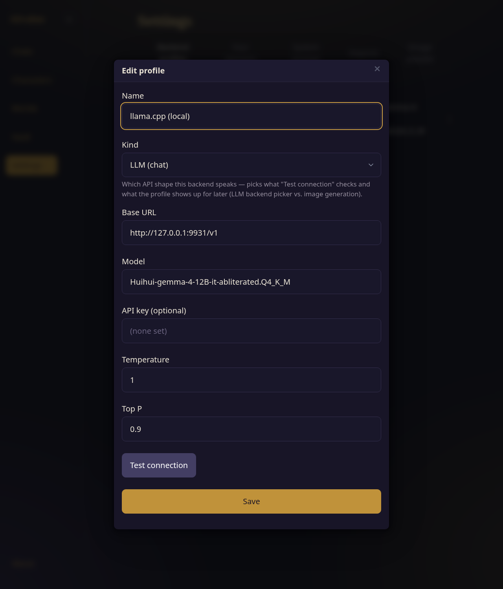
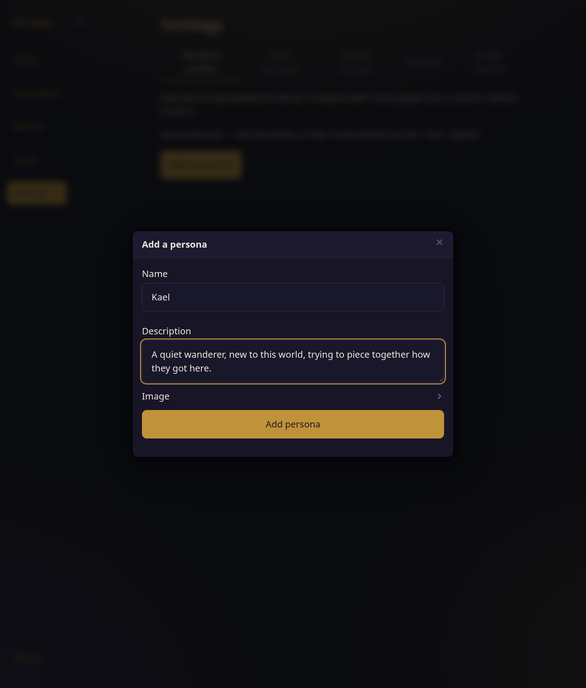
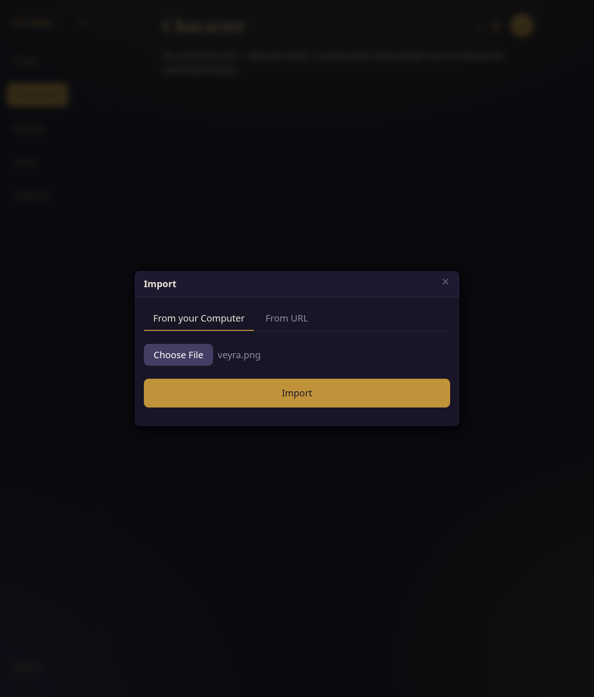
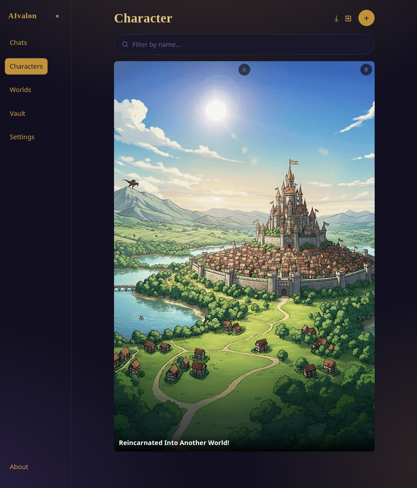
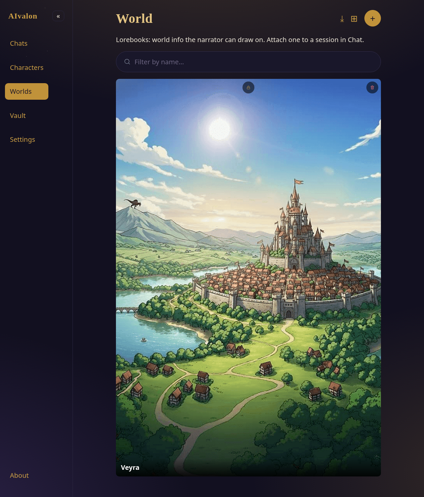
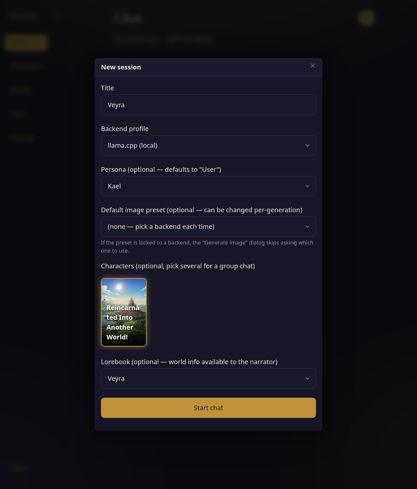
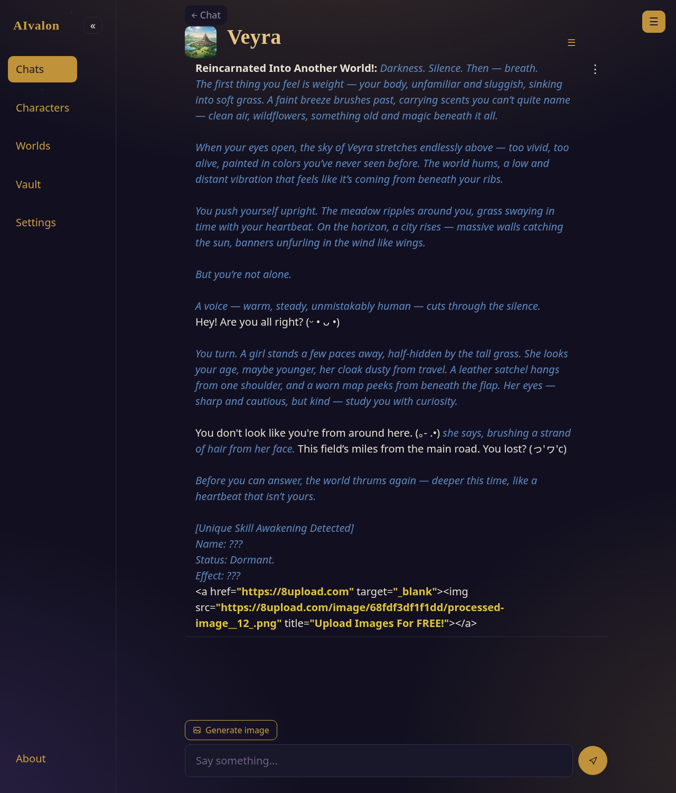
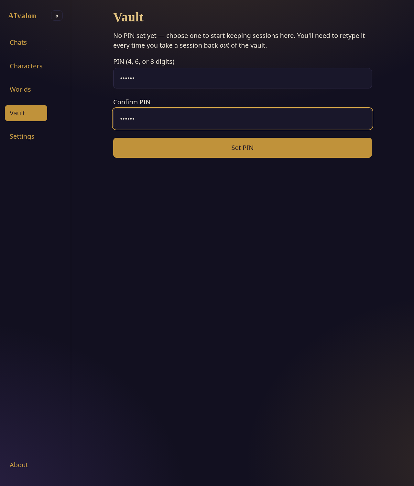
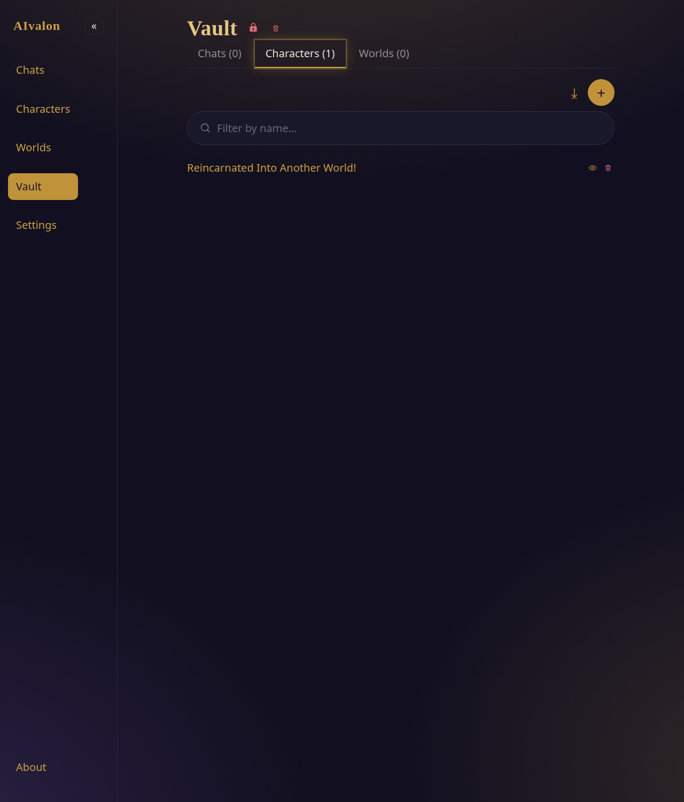

# AIvalon

🇬🇧 [Read in English](README.md)

Une application web locale, mono-utilisateur, pour le roleplay avec une IA.
Elle remplace les applications hébergées et limitées : vous parlez à un LLM qui tourne sur votre propre machine, via des fiches de personnage et des lorebooks que vous contrôlez, et rien ne quitte votre ordinateur.

> **Statut : v0.2-beta-1, génération d'image désactivée par défaut.**
> Le chat, les fiches de personnage, les personas, les lorebooks, les profils de backend et le Vault (verrouillé par PIN, entièrement chiffré au repos) fonctionnent de bout en bout contre un vrai backend LLM.
> La génération d'image (contre un backend AUTOMATIC1111/Forge) est codée mais **désactivée par défaut dans cette release** — elle n'a pas encore eu de vraie passe de validation. `docs/DESIGN.md` reste la référence pour ce qui est tranché ou encore ouvert.

**Langue :** un petit badge au-dessus du lien **About** dans la barre latérale change la langue de l'interface — anglais par défaut, d'autres s'ajoutent en déposant un fichier `.json` dans `web/static/i18n/` (le français est fourni avec cette release). Ça indique aussi au backend LLM de répondre dans cette langue. Tous les écrans ne sont pas encore traduits : la nav, la barre latérale et la page About le sont ; Chat/Character/World/Vault/Settings affichent encore du texte anglais quel que soit le sélecteur (suivi dans la section Internationalization de `docs/DESIGN.md`).

## Démarrage

Tout ce qui suit fonctionne pareil sous Windows et Linux — les captures viennent de Linux, côté Windows c'est juste un `.exe` et des doubles-clics à la place d'un terminal.

### 1. Installation (recommandée : l'installeur en une commande)

Lancez `./scripts/install.sh` (Linux) ou `scripts/install.ps1` (Windows : `powershell -NoProfile -ExecutionPolicy Bypass -File install.ps1`). C'est la seule commande. Il demande un dossier d'installation, puis télécharge et décompresse llama.cpp (build CPU), un modèle d'entrée de gamme fourni par défaut ([Qwen2.5-3B-Instruct](https://huggingface.co/bartowski/Qwen2.5-3B-Instruct-GGUF), ~2 Go) et AIvalon lui-même. À la fin, il propose de créer un raccourci : sur le bureau sous Windows, dans le menu des applications sous Linux. Rien d'autre à faire. Lancez le script de démarrage généré (`run-aivalon.sh` / `run-aivalon.ps1`, dans le dossier d'installation) et ouvrez `http://127.0.0.1:4140`.

Le script de démarrage lance llama.cpp pour vous, et AIvalon l'arrête en quittant. Pendant le chargement du modèle, le navigateur affiche un écran de chargement qui laisse place à l'application tout seul. Un profil de backend **llama.cpp (local)** préconfiguré pointe déjà dessus. Relancer l'installeur saute ce qui est déjà en place.

### Avancé / à la main

Passez-vous de l'installeur si vous voulez un autre modèle ou un plus gros, une build GPU de llama.cpp, votre propre backend (Ollama, une API hébergée), ou simplement voir ce qui se passe.

#### Faire tourner un LLM local (llama.cpp)

AIvalon n'embarque jamais l'inférence lui-même — il parle à n'importe quel backend compatible OpenAI via HTTP. Le serveur de [llama.cpp](https://github.com/ggml-org/llama.cpp) est l'option locale la plus directe et c'est ce qu'utilisent ces instructions ; [Ollama](https://ollama.com/) marche aussi si vous préférez gérer vos modèles comme ça.

1. Téléchargez une archive prête à l'emploi depuis la [page Releases de llama.cpp](https://github.com/ggml-org/llama.cpp/releases) correspondant à votre OS et votre GPU : `cuda` pour une carte Nvidia, `vulkan` comme repli universel (AMD/Intel/Nvidia), `cpu` tout court si vous n'avez pas de GPU valable. Dézippez n'importe où — rien à installer. L'exécutable du serveur à l'intérieur s'appelle `llama-server` dans la plupart des versions (certaines plus récentes exposent plutôt un CLI unifié `llama` avec une sous-commande `serve` — c'est la même chose, adaptez la commande ci-dessous en conséquence).
2. Récupérez un modèle au format **GGUF**. Choisissez le palier qui correspond à la VRAM de votre GPU :

   | Palier                 | Modèle                                                                                                          | VRAM (approx.)     | Notes                                                                                                                                     |
   | ---------------------- | --------------------------------------------------------------------------------------------------------------- | ------------------ | ----------------------------------------------------------------------------------------------------------------------------------------- |
   | Bas de gamme (~3B)     | [Qwen2.5-3B-Instruct-GGUF](https://huggingface.co/bartowski/Qwen2.5-3B-Instruct-GGUF)                           | ~2 Go en Q4_K_M    | Généraliste, pas spécifiquement conçu pour le roleplay, mais le meilleur compromis à cette taille. Tourne sur presque n'importe quel GPU. |
   | Milieu de gamme (~8B)  | [Huihui-Qwen3-8B-abliterated-v2](https://huggingface.co/huihui-ai/Huihui-Qwen3-8B-abliterated-v2)               | ~5 Go en Q4_K_M    | Bonne adhérence aux fiches de personnage, tient confortablement sur une carte 8 Go.                                                       |
   | Milieu de gamme (~12B) | [Huihui-gemma-4-12B-it-abliterated](https://huggingface.co/mradermacher/Huihui-gemma-4-12B-it-abliterated-GGUF) | ~9-10 Go en Q4/Q5  | Un cran au-dessus si vous avez 12 Go (ex. une RTX 4070 Ti), nettement plus cohérent sur de longues scènes.                                |
   | Haut de gamme (~24B)   | [Dolphin3.0-Mistral-24B](https://huggingface.co/dphn/Dolphin3.0-Mistral-24B)                                    | ~16-20 Go en Q4-Q6 | Modèle dense 24B, le choix établi pour du texte créatif/roleplay long format une fois la VRAM disponible.                                 |

   "Abliterated" signifie que la couche de refus/alignement du modèle a été retirée — la raison habituelle pour laquelle un modèle est listé ici plutôt que sa version instruct normale, c'est que les modèles instruct standards ont tendance à sortir du personnage et à glisser des avertissements de sécurité en pleine scène. Reprenez le GGUF non-abliterated du même modèle de base si vous préférez garder cette couche ; AIvalon s'en moque, peu importe lequel vous lui pointez.
3. Mettez le(s) fichier(s) `.gguf` dans un dossier, puis lancez le serveur pointé dessus :

   ```sh
   llama-server -cmoe -rea off --sleep-idle-seconds 15 -c 8192 --models-dir <chemin vers votre dossier de modèles>
   ```

   Ce que fait chaque option :
   - `--models-dir` fait tourner llama.cpp en **mode routeur**, servant chaque modèle du dossier — c'est ce qui permet au "Test connection" d'AIvalon de les détecter et de les lister plus bas.
   - `-cmoe` (`--cpu-moe`) garde les poids Mixture-of-Experts sur le CPU — économise de la VRAM sur les modèles MoE, sans effet sur les modèles denses.
   - `-rea off` (`--reasoning off`) coupe la sortie de "réflexion" en chaîne — vous voulez la réponse du personnage, pas sa trace de raisonnement visible, pour du roleplay.
   - `--sleep-idle-seconds 15` décharge le modèle de la VRAM après 15 secondes d'inactivité, libérant le GPU pour autre chose en attendant.
   - `-c 8192` (`--ctx-size`) est la fenêtre de contexte, en tokens. Gardez le budget de contexte propre à AIvalon (Settings → System prompt) confortablement en dessous.

   Laissez ça tourner dans son propre terminal (ou en service en arrière-plan, une fois passé la phase de test). Si vous préférez qu'AIvalon le lance et l'arrête pour vous comme avec l'installeur, définissez plutôt `AIVALON_LLAMA_BIN` et `AIVALON_LLAMA_MODELS_DIR` (voir Variables d'environnement plus bas).

#### Récupérer AIvalon

Téléchargez l'archive de release pour votre OS (`aivalon-linux-x64.tar.gz` / `aivalon-windows-x64.zip`), extrayez-la n'importe où, et lancez l'exécutable depuis son dossier. Pas de runtime séparé à installer. Gardez le dossier `web/` à côté du binaire. Sous Windows, SmartScreen peut afficher un avertissement parce que le binaire n'est pas signé.

AIvalon écoute sur `http://127.0.0.1:4140` par défaut — ouvrez cette adresse dans un navigateur.

### 2. Réglages du premier lancement

Si vous êtes passé par l'installeur, le profil **llama.cpp (local)** est déjà configuré (Temperature 1.0, Top P 0.9), donc passez directement au persona plus bas. Sinon, modifiez ce profil ou ouvrez **Settings → Backend profiles → Add a profile**, donnez-lui un nom, pointez **Base URL** vers votre serveur llama.cpp (ex. `http://127.0.0.1:9931/v1`), puis cliquez sur **Test connection** — un test réussi liste chaque modèle trouvé par le serveur et transforme le champ Model en liste déroulante pour en choisir un plutôt que de le taper à la main. Pour du roleplay, **Temperature ≈ 1.0** et **Top P ≈ 0.9** sont un bon point de départ — plus cohérent que l'échantillonnage par défaut, sans être plat.



Ensuite, sur l'onglet **Your persona**, ajoutez-vous vous-même comme persona — qui vous êtes pour l'IA, séparé des personnages qu'elle joue. Optionnel : un chat sans persona choisi utilise juste un "User" par défaut intégré.



### 3. Importer un personnage (et son lorebook)

Les fiches de personnage utilisent le format ouvert compatible SillyTavern, donc tout ce qui est exporté depuis des sites construits autour de ce format marche ici aussi. En exemple : [Veyra sur Character Tavern](https://character-tavern.com/character/baconery/veyra) — cliquez le bouton violet **Download character card** (PNG, lorebook inclus). Ce seul téléchargement donne à la fois un personnage *et* un lorebook, puisque la fiche a une section de lore/monde embarquée dedans.

Allez dans **Characters**, cliquez le bouton d'import ⤓, et déposez le PNG :



Le personnage arrive dans votre liste, et son lorebook embarqué apparaît tout seul dans **Worlds** — rien à faire en plus :




### 4. Démarrer votre premier chat

Allez dans **Chat → New session** : choisissez un titre (ex. "Veyra"), votre profil de backend, votre persona, le(s) personnage(s) que vous venez d'importer, et le lorebook, puis **Start chat**.





## Le Vault

Un espace verrouillé par PIN pour sortir une fiche de personnage, un lorebook, ou une session entière de la vue courante — un PIN à 4, 6 ou 8 chiffres de votre choix, redemandé chaque fois que vous ouvrez le Vault ou ressortez quelque chose — avec un blocage temporaire après plusieurs mauvais essais. Tout ce qui est caché là-dedans — images de session, portraits de personnage, couvertures de lorebook — est **chiffré au repos** (AES-256-GCM), pas juste masqué derrière une porte d'interface : regarder directement les fichiers sur le disque ne donne que du chiffré, pas une image.




## Ce que ça fait

- **Fiches de personnage**, suivant la spec Character Card V2/V3 (le même format utilisé dans tout l'écosystème proche de SillyTavern) : import depuis un PNG (fiche embarquée dans un chunk `tEXt`) ou du JSON brut, depuis un fichier ou une URL, ou écrite à la main. Plusieurs images de référence par fiche, l'une d'elles promouvable en avatar principal.
- **Personas** : votre propre profil en tant que joueur humain, séparé des personnages joués par l'IA. Optionnel — une session sans persona choisi retombe sur un défaut intégré.
- **Lorebooks** (World Info) : du lore partagé volontairement séparé des fiches de personnage, avec une stratégie de déclenchement par entrée (`constant` ou `selective` sur mot entier), un ordre d'insertion, et une probabilité. Importables comme les fiches de personnage, et auto-extraits d'une fiche qui en embarque un.
- **Chat**, avec plusieurs fiches de personnage dans une session pour du roleplay de groupe : streaming token par token en SSE, avec regénération, édition, branchement (forker la conversation depuis n'importe quel point) et suppression par message, plus duplication de session et fond d'écran personnalisé par session.
- **N'importe quel backend LLM compatible OpenAI** : pointez un ou plusieurs profils de backend vers Ollama, un serveur llama.cpp, ou une API hébergée, avec un test de connexion depuis Settings — AIvalon n'embarque jamais l'inférence lui-même.
- **Génération d'image à la demande** *(désactivée par défaut dans les builds de release, pas encore validée)*, contre un backend AUTOMATIC1111 (A1111)/Forge Stable Diffusion WebUI. Des presets d'image nommés (steps, CFG scale, sampler, taille, seed, prompt négatif, suffixe de style) sont gérés une fois dans Settings, et une session en choisit juste un ; la fenêtre de génération ne demande jamais que le prompt.
- **Le Vault** — voir plus haut.
- **Settings** : profils de backend, personas, le gabarit de system prompt, un budget de contexte (plafond de caractères envoyés par réponse), et la liste blanche de domaines pour "importer une fiche depuis une URL".

Le raisonnement complet derrière chacun de ces choix est dans `docs/DESIGN.md`.

## Installation (pour les développeurs / build depuis les sources)

La section au-dessus s'adresse à tout le monde — celle-ci concerne la construction d'AIvalon lui-même plutôt que l'exécution d'une release.

### Prérequis

1. **Go 1.22 ou plus récent** — [go.dev/dl](https://go.dev/dl/).
2. Un backend LLM local pour tester (voir Démarrage plus haut).

### Build et lancement

```sh
git clone https://github.com/Lord-ZuzurNC/AIvalon.git
cd AIvalon
go build -o aivalon ./cmd/aivalon
./aivalon
```

### Variables d'environnement

| Variable                            | Défaut           | Usage                                                                                                                                                                                                                                                                                |
| ----------------------------------- | ---------------- | ------------------------------------------------------------------------------------------------------------------------------------------------------------------------------------------------------------------------------------------------------------------------------------ |
| `AIVALON_ADDR`                      | `127.0.0.1:4140` | Adresse d'écoute. Mettre une adresse non-loopback relâche la garde anti-DNS-rebinding pour les en-têtes Host en LAN privé sur le même port.                                                                                                                                          |
| `AIVALON_DB`                        | `aivalon.db`     | Chemin du fichier SQLite, pour que deux instances ne se battent pas sur la même base.                                                                                                                                                                                                |
| `AIVALON_TRANSLATE_TIMEOUT_SECONDS` | `200`            | Timeout (secondes) par champ/entrée pour la traduction à l'import de cartes/lorebooks — à augmenter si un modèle local lent coupe en pleine génération, voir `docs/DESIGN.md`.                                                                                                       |
| `AIVALON_LLAMA_BIN`                 | *(non défini)*   | Chemin de `llama-server`. À définir avec `AIVALON_LLAMA_MODELS_DIR` pour qu'AIvalon lance llama.cpp lui-même (mode routeur, sur le port du profil "llama.cpp (local)"), attende qu'il soit prêt, et l'arrête en quittant. Laissez les deux vides pour utiliser votre propre backend. |
| `AIVALON_LLAMA_MODELS_DIR`          | *(non défini)*   | Dossier des modèles `.gguf` servis par ce processus llama.cpp.                                                                                                                                                                                                                       |

## Stack technique (résumé)

- **Go**, binaire statique unique — aucun runtime à installer pour les utilisateurs finaux.
- **SQLite** (`modernc.org/sqlite`, pur Go, sans cgo) pour le stockage ; `goose` pour les migrations.
- **htmx** + templates Go rendus serveur (`templ`) pour l'UI — pas de build JavaScript séparé, pas de dépendance Node/npm.
- **Server-Sent Events** pour le streaming des tokens de chat.
- Parle à n'importe quelle API `chat/completions` compatible OpenAI et à un endpoint `/sdapi/v1/txt2img` compatible A1111 ; n'embarque jamais de moteur d'inférence ou de génération d'image.

Le raisonnement complet derrière chaque choix ci-dessus — y compris ce qui a été envisagé puis rejeté — vit dans `docs/DESIGN.md`.

## Développement

```sh
go install github.com/a-h/templ/cmd/templ@latest   # régénère .templ -> _templ.go après modification d'un template
go install github.com/pressly/goose/v3/cmd/goose@latest   # ajoute/lance des migrations DB

templ generate && go build -o aivalon ./cmd/aivalon
go test ./...
```

Les migrations vivent en fichiers `.sql` bruts dans `internal/db/migrations/` ; ajoutez-en une nouvelle plutôt que de modifier une migration existante. Les fichiers `_templ.go` générés sont commités, donc un simple `go build` fonctionne sans le CLI `templ` installé — seule la modification d'un fichier `.templ` l'exige.

## Licence

AGPLv3 — voir `LICENSE`.
Faire tourner AIvalon localement, pour vous-même, n'impose aucune obligation.
Le modifier et le faire tourner comme service réseau pour d'autres personnes implique de publier ces modifications.
